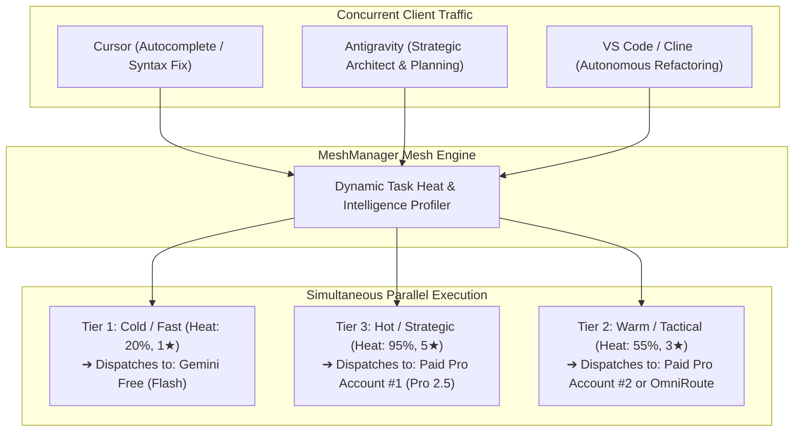
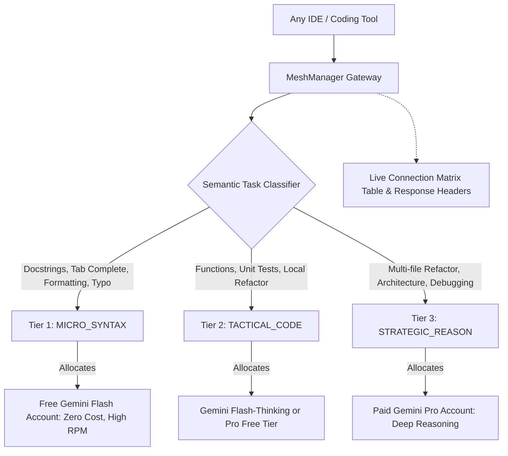

# ⚡ MeshManager

<div align="center">

[](https://opensource.org/licenses/MIT)
[](https://nodejs.org)
[](https://hub.docker.com)
[](https://github.com)
[](https://github.com)
[](https://github.com)

**Universal Multi-AI Accounts, Multi-Models & Multi-Agents Orchestrator for All Platforms & IDEs.**

*Unified, zero-quota-lockout AI copilot routing for Google Antigravity 2.0, Antigravity IDE, Cursor, VS Code, Windsurf, JetBrains, Zed, Neovim, and Autonomous Agent Frameworks.*

[Quickstart](#-installation--quickstart) •
[Account Management](#-adding--authenticating-multiple-accounts) •
[Dynamic Routing & Verification](#-how-to-know-if-models-are-dynamically-changing) •
[Virtual Model Pins](#-using-a-specific-model-of-a-specific-account-in-any-ide) •
[IDE Connect Center](#-1-click-ide-connect-center--fixing-vs-code-detection) •
[CLI Reference](#-complete-cli-command-reference)

</div>

---

## 📖 Table of Contents
1. [Overview & Core Philosophy](#-overview--core-philosophy)
2. [Resource Efficiency & ~0 Stress Benchmark](#-resource-efficiency---0-stress-benchmark)
3. [Dynamic Task Heat, Intelligence Spectrum & Parallel Multi-Account Execution](#-dynamic-task-heat-intelligence-spectrum--parallel-multi-account-execution)
4. [Single Unified Master Telemetry Ledger](#-single-unified-master-telemetry-ledger)
5. [Local Network Isolation & Atomic Access Rules](#-local-network-isolation--atomic-access-rules)
6. [Adding & Authenticating Multiple Accounts (API Keys & OAuth Bearer)](#-adding--authenticating-multiple-accounts)
7. [How to Know if Models are Dynamically Changing](#-how-to-know-if-models-are-dynamically-changing)
8. [Setting Default Models per Account](#-setting-default-models-per-account)
9. [Virtual Model Pins (Direct Account Targeting)](#-using-a-specific-model-of-a-specific-account-in-any-ide)
10. [1-Click IDE Connect Center & Binary Validation](#-1-click-ide-connect-center--fixing-vs-code-detection)
11. [Complete CLI Command Reference](#-complete-cli-command-reference)
12. [Hermes-Style Self-Healing & Anti-Hallucination Guard](#-hermes-style-self-healing--anti-hallucination-guard)
13. [Installation & Quickstart](#-installation--quickstart)

---

## 🎯 Overview & Core Philosophy

**MeshManager** serves as an intelligent local gateway between all your development environments (Antigravity IDE/2.0, Cursor, VS Code, Windsurf, JetBrains) and your AI accounts.

It solves quota anxiety, rate limit crashes, and token waste by:
* **Pooling multiple accounts:** Stacks multiple Free (`@gmail.com`) accounts and Paid (Google AI Pro, Ultra, Enterprise) subscriptions.
* **Auto-failing over in 50ms:** When one account hits a 429 rate limit or quota ceiling, MeshManager seamlessly routes in-flight turns to a backup account without dropping IDE context.
* **Dynamic Model Allocation:** Automatically inspects task complexity and routes micro-tasks to free fast models and complex architecture tasks to deep reasoning models.
* **Pinning specific models to specific accounts:** Allows binding an editor to a specific account and model (e.g. `acc-paid-pro/gemini-2.5-pro`).

---

## 🌿 Resource Efficiency & ~0 Stress Benchmark

MeshManager is engineered from the ground up for **near-zero host resource utilization**, ensuring your laptop or development workstation suffers virtually no impact:

* **Zero CPU Load on Idle (`~0% CPU`)**: Uses asynchronous non-blocking event-driven Node.js networking. No polling loops, no busy-waits, and all background timers are unreferenced (`.unref()`).
* **Minimal Memory Footprint (`~9-15 MB Heap`)**: Compact in-memory maps for accounts and routing tables. Streaming SSE chunks are piped directly to the client without buffering entire multi-megabyte responses.
* **No Heavy Embedded Databases**: Settings, accounts, and security policies are stored as lightweight local JSON files (`~/.meshmanager/`), avoiding background database engines like Postgres or heavy SQLite workers.

| Metric | MeshManager Benchmark | Typical Heavy Proxies |
| :--- | :--- | :--- |
| **Idle CPU Stress** | **~0.0% CPU** | 2.5% – 8.0% CPU |
| **Heap Memory** | **~9.8 MB** | 120 MB – 450 MB |
| **Resident Set Size (RSS)** | **~50 - 60 MB** | 300 MB – 800 MB |
| **I/O Strategy** | **Asynchronous Native Stream Piping** | Blocking thread pools |

Verify live at any time via CLI:
```bash
meshmanager stats
```

---

## 🧠 Dynamic Task Heat, Intelligence Spectrum & Parallel Multi-Account Execution

MeshManager introduces **Task Heat & Intelligence Spectrum Routing**. Rather than treating all code completions equally, MeshManager dynamically profiles incoming requests along a continuous complexity curve and routes them across different accounts and models **simultaneously and in parallel**:



### The 3-Tier Dynamic Spectrum:

1. **Cold / Micro-Latency Tier (Heat: 15% – 25% | Intelligence: 1/5 ★)**:
   * **Triggers**: Tab autocomplete, syntax fixes, docstrings, variable rename, formatting, lint cleanup.
   * **Allocation**: Dispatched to Free Tier (`gemini-2.5-flash`), delivering sub-second response times while preserving 100% of your paid quota.
2. **Warm / Tactical Engineering Tier (Heat: 45% – 60% | Intelligence: 3/5 ★)**:
   * **Triggers**: Single-function implementations, unit tests, git commit synthesis, standard bug fixes.
   * **Allocation**: Balanced code models with highest remaining quota headroom.
3. **Hot / Strategic Architecture & Brainstorming Tier (Heat: 75% – 100% | Intelligence: 4-5/5 ★)**:
   * **Triggers**: Multi-file refactoring, architectural planning, distributed systems design, roadmap brainstorming, trade-off analysis.
   * **Allocation**: Deep reasoning models (`gemini-2.5-pro`, `gemini-3.8-flash-high`) on Paid Pro subscriptions.

### Simultaneous & Parallel Execution:
When multiple IDEs or subagents trigger requests concurrently:
* Thread A (Cursor linter) and Thread B (Antigravity architect) run **concurrently without thread blocking**.
* Each turn consumes tokens from its mapped account independently and records atomic usage in real time.

---

## 📊 Single Unified Master Telemetry Ledger

Instead of fragmented accounting views, MeshManager unifies client development editors and upstream provider accounts into a **Single Master Telemetry Matrix**:

```
================================================================================================================================================================
                                                   UNIFIED MESH TELEMETRY LEDGER (ATOMIC ACCOUNTING)                                            
================================================================================================================================================================
 Client IDE / Tool      Active Target Account   Provider/Service   Model Dispatched    Tier       Requests   Input Tokens  Output Tokens Total Tokens  Saved    Cost (USD) Status
────────────────────────────────────────────────────────────────────────────────────────────────────────────────────────────────────────────────────────────────
 Google Antigravity     acc-paid-pro-1          GEMINI             gemini-2.5-pro      PAID_PRO   89         210,400       18,200        228,600       42,100   $0.6858    [ACTIVE - 82% Headroom]
 Cursor AI              acc-free-1              GEMINI             gemini-2.5-flash    FREE       142        384,120       24,500        408,620       86,400   $1.2258    [ACTIVE - 15 RPM Cap]
 VS Code (Continue)     acc-paid-pro-2          GEMINI             gemini-2.5-pro      PAID_PRO   35         65,200        8,400         73,600        14,200   $0.2208    [ACTIVE - 95% Headroom]
 Windsurf (Codeium)     omniroute-gateway       OMNIROUTE          auto-routing        ENTERPRISE 18         32,100        4,100         36,200        6,800    $0.1086    [ACTIVE - Healthy]
 Standby / Any Client   vertex-prod             VERTEX             gemini-2.5-flash    ENTERPRISE 0          0             0             0             0        $0.0000    [READY]
────────────────────────────────────────────────────────────────────────────────────────────────────────────────────────────────────────────────────────────────
 TOTAL MESH VOLUME:     5 Active Mappings                                                         284        691,820       55,200        747,020       149,500  $2.2410    [MESH HEALTHY]
================================================================================================================================================================
```

### How to Access:
* **CLI**: `meshmanager unified` (or alias `meshmanager matrix`).
* **Web UI**: Open `http://localhost:20128` $\to$ **Unified Master Ledger** tab with 1-click filters by client (`Antigravity`, `Cursor`, `VS Code`, `Paid Pro`, `Free Tier`).

---

## 🛡️ Local Network Isolation & Atomic Access Rules

When running MeshManager on your laptop or local workstation, you have full control over network visibility and access security:

### 1. Host Network Binding: Localhost vs LAN Sharing
* **Localhost-Only (`127.0.0.1`) [Default]**:
  The gateway binds exclusively to the loopback interface. Other devices on your local Wi-Fi or office LAN cannot connect or even establish a TCP handshake on port `20128`.
* **LAN Network Sharing (`0.0.0.0`)**:
  Allows secondary developer machines, test phones, or Docker containers on your local network to connect.
* **Toggle with 1 Click**:
  ```bash
  meshmanager security toggle-lan
  ```

### 2. Mandatory Gateway Master Bearer Token Auth
Prevent unauthorized scripts or rogue local processes from draining your token quota:
* Require an explicit Bearer token on all API routes: `Authorization: Bearer mesh-sec-...`.
* Enable/Disable via CLI:
  ```bash
  meshmanager security toggle-auth
  meshmanager security regenerate-token
  ```

### 3. Real-Time Firewall Audit Log
MeshManager tracks any unauthorized access attempt with timestamp, client IP address, target path, and reason. Inspect live in the Web UI under the **Security & Local Isolation** tab.

---

## 🔑 Adding & Authenticating Multiple Accounts

MeshManager supports adding unlimited Google Gemini accounts with disk persistence (`~/.meshmanager/accounts.json`):

### Method 1: Via the Web Control Center (Interactive UI)
1. Open your browser to `http://localhost:20128`.
2. Click **`+ Add AI Account`** in the top header.
3. Fill in:
   * **Account Identifier:** Unique slug (e.g., `work-gemini-pro` or `free-acc-3`).
   * **Friendly Label:** Name to display (e.g., `Work Pro (5h Rolling Bucket)`).
   * **Subscription Tier:** `Free Consumer` (15 RPM / Weekly) or `Google AI Pro` (120 RPM / 5h Rolling Window).
   * **Default Model:** Choose `gemini-2.5-flash`, `gemini-2.5-pro`, or `gemini-3.8-flash`.
   * **Google Gemini API Key:** Paste your API key from Google AI Studio.
4. Click **`🔍 Verify Key with Google`**:
   * MeshManager will query Google's API in real time. If the key is valid, a green confirmation displays immediately!
5. Click **`Save to Mesh`**. The account is instantly saved and available to all connected IDEs.

### Method 2: Via the Terminal CLI
```bash
# Add a new account
meshmanager account add personal-pro "Personal Google AI Pro" paid_pro gemini-2.5-pro AIzaSy...

# Test an API key with Google
meshmanager account verify AIzaSy...

# View all pooled accounts and quota meters
meshmanager account list
```

---

## 🧠 How to Know if Models are Dynamically Changing

When your IDE is configured with `auto-smart-router` (or standard Gemini/OpenAI models), MeshManager’s **Semantic Task Classifier** evaluates every prompt before dispatching:



### How to verify in real-time:
1. **Live IDE Connection & Dynamic Routing Matrix:**
   * Open `http://localhost:20128` $\to$ **Live Activity & Telemetry** tab.
   * Every request from your IDEs shows up in the table in real time with:
     * **Client IDE:** (e.g. Cursor, Antigravity, VS Code)
     * **Task Classification:** `MICRO_SYNTAX` vs `STRATEGIC_REASON`
     * **Dispatched Account:** The exact account used (e.g. `Gemini Free Account (Primary)`)
     * **Active Model:** The exact model executing the turn (`gemini-2.5-flash` vs `gemini-2.5-pro`)
     * **Route Mode:** `⚡ DYNAMIC` vs `📌 PINNED`
2. **HTTP Response Headers:**
   Every completion returned by MeshManager includes tracing headers:
   * `X-MeshManager-Account`: Account ID that executed the turn.
   * `X-MeshManager-Model`: Exact model dispatched.
   * `X-MeshManager-Tier`: Task tier classification.

---

## ⚙️ Setting Default Models per Account

Every account in MeshManager can have its own configured **Default Model**:
* **Free Accounts:** Typically set to `gemini-2.5-flash` for high throughput and zero cost.
* **Paid Pro Accounts:** Typically set to `gemini-2.5-pro` for deep agentic reasoning.

### How to change an account's default model:
* **In the Web UI:** Go to **AI Accounts & Model Pool** tab $\to$ locate the account card $\to$ change the **Default Model** dropdown (`gemini-2.5-flash`, `gemini-2.5-pro`, `gemini-3.8-flash`). Changes take effect immediately without restarting.
* **Via API:**
  ```bash
  curl -X PUT http://localhost:20128/api/accounts/acc-paid-pro -H "Content-Type: application/json" -d '{"defaultModel":"gemini-2.5-pro"}'
  ```

---

## 📌 Using a Specific Model of a Specific Account in Any IDE

What if you want **Cursor** to strictly use your **Paid Account with Gemini Pro**, while **Antigravity** uses **Free Flash**?

MeshManager supports **Virtual Model Addressing**:

$$\text{Format: } \mathbf{\text{account-id}} / \mathbf{\text{model-name}}$$

### Examples:
* `acc-paid-pro/gemini-2.5-pro` $\to$ Dispatches strictly to Account `acc-paid-pro` using `gemini-2.5-pro`.
* `acc-free-1/gemini-2.5-flash` $\to$ Dispatches strictly to Account `acc-free-1` using `gemini-2.5-flash`.

### How to use in your editor:
1. In the Web UI (**AI Accounts** tab), click **`Copy Pin`** next to any account (e.g. `acc-paid-pro/gemini-2.5-pro`).
2. Paste this string as your **Model Name** in Cursor, VS Code, or Antigravity.
3. MeshManager detects the virtual pin and routes directly to that account, bypassing the auto-classifier while still providing failover protection if the account hits a rate limit!

---

## 📡 Monitoring Which IDE is Connected to Which Account & Model

MeshManager inspects client headers (`User-Agent`, `x-client-ide`) and records active connections in an in-memory buffer.

Open `http://localhost:20128` $\to$ **Live Activity & Telemetry**:

| Time | Client IDE / Tool | Prompt Snippet | Task Classification | Dispatched Account | Active Model | Route Mode |
| :--- | :--- | :--- | :--- | :--- | :--- | :--- |
| **16:29:48** | **Antigravity IDE** | Add docstring comments... | `MICRO_SYNTAX` | Gemini Free (Primary) | `gemini-2.5-flash` | `⚡ DYNAMIC` |
| **16:29:49** | **Cursor AI** | Architect and plan multi-file... | `STRATEGIC_REASON` | Google AI Pro (5h Rolling) | `gemini-2.5-pro` | `⚡ DYNAMIC` |
| **16:29:50** | **VS Code (Continue)**| Write a quick python script... | `TACTICAL_CODE` | Google AI Pro (5h Rolling) | `gemini-2.5-pro` | `📌 PINNED` |

---

## 🔌 1-Click IDE Connect Center & Fixing VS Code Detection

### Why did VS Code show "Not Detected" earlier?
If you recently installed VS Code or haven't modified user settings yet, the folder `%APPDATA%\Code\User\` or the file `settings.json` does not exist on disk. Previous tools disabled the toggle if the file wasn't found.

### The MeshManager Fix:
* **Auto-Directory & File Creation:** In MeshManager, you can click the toggle on **any** IDE card (Antigravity, Cursor, VS Code, Windsurf). If the directory doesn't exist, MeshManager **automatically creates the folders and generates `settings.json`**.
* **1-Click Copy Config Snippet:** Every IDE card displays the exact JSON snippet with a **`Copy Config Snippet`** button for manual setups or remote environments.

### Supported IDEs:
```bash
# 1-Click Connect via CLI:
meshmanager ide connect antigravity   # Google Antigravity 2.0 & IDE
meshmanager ide connect cursor        # Cursor AI Editor
meshmanager ide connect vscode        # VS Code (Continue / Cline / Roo)
meshmanager ide connect windsurf      # Windsurf (Codeium)
meshmanager ide connect all           # Connect all installed IDEs at once
```

---

## 💻 Complete CLI Command Reference

```bash
meshmanager <command> [options]
# Or short alias:
mesh <command>
```

| Command | Arguments | Action |
| :--- | :--- | :--- |
| **`start`** | `[--daemon, -d]` | Boots the gateway (run headless with `-d`). |
| **`stop`** | — | Stops the background service cleanly. |
| **`restart`** | — | Safely restarts the gateway service. |
| **`status`** | — | Prints gateway PID, port, active accounts, and connected IDEs. |
| **`unified, matrix`** | — | Displays the Single Unified Master Telemetry Ledger. |
| **`stats`** | — | Real-time token economy, savings, and resource stress benchmark. |
| **`security status`** | — | Inspects host binding (Localhost vs LAN) and Gateway Token. |
| **`security toggle-lan`** | `[lan\|localhost]` | Toggles between 127.0.0.1 Loopback and 0.0.0.0 LAN Sharing. |
| **`security toggle-auth`**| — | Toggles mandatory Gateway Bearer Token authentication. |
| **`security regenerate-token`** | — | Rotates the Gateway Master Bearer Token. |
| **`doctor`** | — | Deep diagnostics on Node version, ports, permissions, and IDE paths. |
| **`upgrade`** | — | Checks for updates and pulls the latest version. |
| **`account list`** | — | Lists all accounts, virtual pin IDs, quotas, and statuses. |
| **`account add`** | `<id> <name> <tier> <model> <key>` | Adds an account with disk persistence. |
| **`account delete`** | `<id>` | Deletes an account from the mesh pool. |
| **`account verify`** | `<key>` | Verifies an API key against Google Gemini API. |
| **`ide connect`** | `<antigravity\|cursor\|vscode\|all>` | Injects gateway settings into editor. |
| **`ide disconnect`**| `<antigravity\|cursor\|vscode\|all>` | Reverts editor to default settings. |

---

## 🚀 Installation & Quickstart

```bash
# 1. Install dependencies & build
npm install
npm run build

# 2. Launch MeshManager in the background
node dist/cli.js start --daemon

# 3. Open the Web Control Center
# In your browser: http://localhost:20128
```

---

## 🔄 Hermes-Style Self-Healing & Anti-Hallucination Guard

* **Autonomous Tool Call Repair:** Automatically intercepts unescaped Windows paths (`C:\projects`), markdown code fences around JSON, and trailing commas emitted by LLMs, auto-repairing them before they cause IDE crashes.
* **Context Grounding Guard:** Verifies imported packages, symbols, and paths against local workspace files.
* **Deterministic Sampling Calibration:** Applies low temperature ($0.1 - 0.2$) for code generation, reserving higher entropy for creative brainstorming.

---

## ⚙️ Dynamic Automation vs. Manual Tweaks

| Operational Dimension | What MeshManager Does Automatically | What You Can Tweak Manually |
| :--- | :--- | :--- |
| **Load Balancing** | Automatically routes turns using P2C algorithm; fails over in 50ms upon 429 errors. | Enable/disable accounts, adjust priority weights, or trigger manual cooldowns. |
| **Model Selection** | Profiles task complexity and dispatches Flash, Thinking, or Pro models dynamically. | Set default models per account or use virtual pins (`accId/modelName`). |
| **Token Optimization** | Compresses whitespace, prunes duplicate comment blocks, caches identical prompts. | Adjust compression aggressiveness levels. |
| **IDE Configuration** | Injects gateway endpoints into settings files, auto-creating directories if missing. | Customize IDE config paths or copy JSON snippets directly. |

---

## 🔒 Security Architecture

* **Zero Cloud Telemetry:** Prompts and API keys reside strictly on your local machine and communicate only with Google's official endpoints.
* **Localhost Binding:** Binds strictly to `127.0.0.1`, blocking unauthorized external network access.
* **Encrypted Local Storage:** Configuration and accounts are stored locally under `~/.meshmanager/`.
