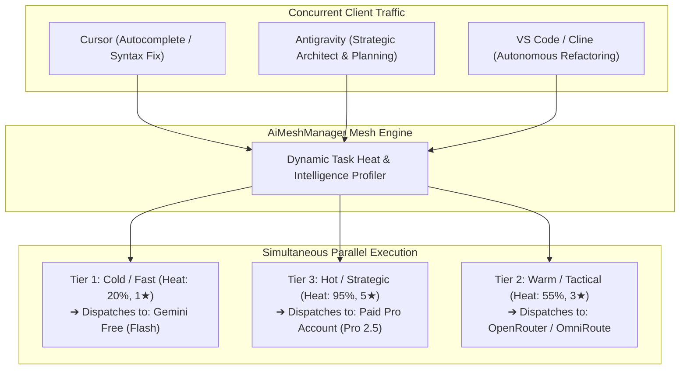
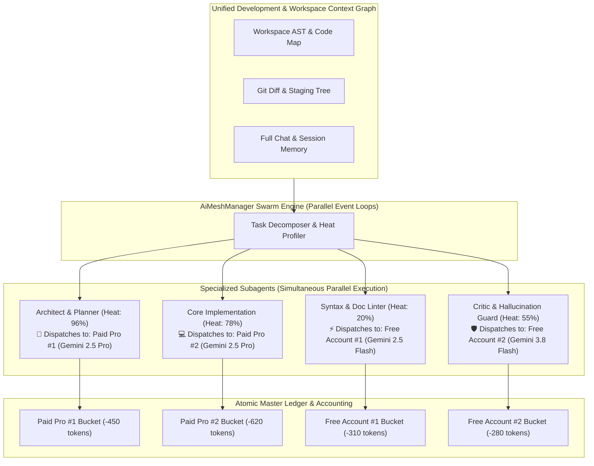
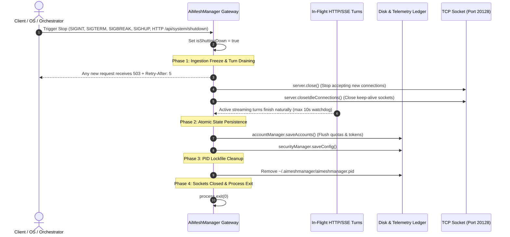

# ⚡ AiMeshManager

<div align="center">

[](https://opensource.org/licenses/MIT)
[](https://nodejs.org)
[](https://hub.docker.com)
[](https://github.com/ommedical/AiMeshManager)
[](https://github.com/ommedical/AiMeshManager)
[](https://github.com/ommedical/AiMeshManager)

**Universal Multi-AI Accounts, Multi-Models & Multi-Agents Orchestrator for All Platforms & IDEs.**

*Unified, zero-quota-lockout AI copilot gateway for Google Antigravity 2.0, Antigravity IDE, Cursor, VS Code, Windsurf, JetBrains, Zed, Neovim, and Autonomous Agent Frameworks.*

[Quickstart](#-installation--quickstart) •
[Account Management](#-zero-config-clean-slate--multi-account-management) •
[Multi-Provider Setup](#-universal-multi-provider-ecosystem) •
[IDE Connect Center](#-1-click-ide-connect-center--binary-validation) •
[Model Intelligence](#-dynamic-model-performance-knowledge-matrix-best-vs-low-models) •
[CLI Reference](#-complete-cli-command-reference)

</div>

---

## 📖 Table of Contents
1. [Overview & Core Philosophy](#-overview--core-philosophy)
2. [Installation & Quickstart](#-installation--quickstart)
3. [Zero-Config Clean Slate & Multi-Account Management](#-zero-config-clean-slate--multi-account-management)
   * [Clean Slate Blank Startup by Default](#1-clean-slate-blank-startup-by-default-100-privacy)
   * [Interactive Account Management: Add, Edit, Delete, Toggle](#2-interactive-account-management-add-edit-delete-toggle)
   * [Live Multi-Provider Credential Verification (`🔍 Test Key`)](#3-live-multi-provider-credential-verification--test-key)
   * [Cryptographic Zero-Residual Secret Purge (`🔥 Purge Stored Secrets`)](#4-cryptographic-zero-residual-secret-purge--file-shredding)
   * [Instant Demo Templates (`🎲 Load Demo Templates`)](#5-instant-demo-templates--load-demo-templates)
4. [Universal Multi-Provider Ecosystem](#-universal-multi-provider-ecosystem)
   * [Google Gemini (AI Studio & Paid Pro)](#1-google-gemini-ai-studio--paid-pro)
   * [OpenRouter (100+ Models & Free Pool)](#2-openrouter-openrouterai)
   * [OmniRoute Gateway](#3-omniroute-gateway-omnirouteonline)
   * [FreeLLMAPI Directory Providers (Groq, Cerebras, SambaNova, Hugging Face)](#4-freellmapi-directory-providers-groq-cerebras-sambanova-hugging-face)
   * [Meta Developer Llama AI (Llama 3.3 / 3.1)](#5-meta-developer-llama-ai-devmetaai)
5. [Local Running Models Support (Ollama, LM Studio, vLLM)](#-local-running-models-support-ollama-lm-studio-vllm)
6. [Dynamic Model Performance Knowledge Matrix (Best vs. Low Models)](#-dynamic-model-performance-knowledge-matrix-best-vs-low-models)
7. [1-Click IDE Connect Center & Binary Validation](#-1-click-ide-connect-center--binary-validation)
   * [Google Antigravity 2.0 Mock ADC Loopback Bypass](#google-antigravity-20-integration--service-account-bypass-mock-adc)
   * [Cursor AI Editor](#cursor-ai-editor)
   * [VS Code (Continue / Cline / Roo Code)](#vs-code-continue--cline--roo-code)
   * [Windsurf (Codeium)](#windsurf-codeium)
8. [Dynamic Task Heat, Intelligence Spectrum & Parallel Multi-Account Routing](#-dynamic-task-heat-intelligence-spectrum--parallel-multi-account-routing)
9. [Virtual Model Pins (`accountId/modelName`) & Default Models](#-virtual-model-pins-accountidmodelname--default-models)
10. [Dynamic Multi-Agent Swarm with Shared Development Context](#-dynamic-multi-agent-swarm-with-shared-development-context)
11. [Single Unified Master Telemetry Ledger](#-single-unified-master-telemetry-ledger)
12. [Local Network Isolation & Mandatory LAN Bearer Token Auth](#-local-network-isolation--mandatory-lan-bearer-token-auth)
13. [Hermes-Style Self-Healing & Anti-Hallucination Guard](#-hermes-style-self-healing--anti-hallucination-guard)
14. [Resource Efficiency & ~0 Stress Benchmark](#-resource-efficiency---0-stress-benchmark)
15. [Complete CLI Command Reference](#-complete-cli-command-reference)
16. [Production Architecture Files: test-e2e.js, Dockerfile & docker-compose.yml](#-production-architecture-files-test-e2ejs-dockerfile--docker-composeyml)
17. [Graceful Shutdown Architecture & Multi-Scenario Service Termination Guide](#-graceful-shutdown-architecture--multi-scenario-service-termination-guide)

---

## 🎯 Overview & Core Philosophy

**AiMeshManager** serves as an intelligent local gateway between all your development environments (Antigravity IDE/2.0, Cursor, VS Code, Windsurf, JetBrains) and your AI accounts.

It eliminates quota anxiety, rate limit crashes, and token waste by:
* **Clean Slate Privacy**: Fresh installations start completely blank with zero pre-configured accounts or credentials stored on your disk. You control every key.
* **Pooling multiple accounts:** Stacks multiple Free (`@gmail.com`) accounts and Paid (Google AI Pro, Ultra, Enterprise, OpenRouter, Meta AI) subscriptions into a single resilient mesh.
* **Auto-failing over in 50ms:** When one account hits a 429 rate limit or quota ceiling, AiMeshManager seamlessly reroutes in-flight turns to a backup account without dropping IDE context.
* **Dynamic Model Allocation:** Automatically inspects task complexity and routes micro-tasks (autocomplete, docstrings) to free fast models and complex architecture tasks to deep reasoning models.
* **Pinning specific models to specific accounts:** Allows binding an editor to a specific account and model (e.g. `acc-paid-pro/gemini-2.5-pro` or `openrouter/deepseek-r1:free`).
* **Zero Host Stress:** Engineered for `~0% CPU` on idle, tiny `~9-15 MB` memory footprint, and non-blocking streaming I/O.

---

## 🚀 Installation & Quickstart

You can run AiMeshManager **natively on your workstation** (zero Docker or Podman required) or inside a lightweight container.

### Method 1: Native Run (Zero Docker or Podman Needed) — Recommended
Runs directly on Node.js (v18+) across Windows, macOS, Linux, WSL, or Android Termux.

1. **Clone the Public Repository:**
   ```bash
   git clone https://github.com/ommedical/AiMeshManager.git
   cd AiMeshManager
   ```
2. **Launch AiMeshManager (1-Command):**
   ```bash
   npm start
   ```
   > ⚡ **Self-Bootstrapping:** If `node_modules` or `dist/` are not yet built, AiMeshManager automatically detects this and installs dependencies (`npm install`) and compiles TypeScript (`npm run build`) before starting!

3. **Open the Web Control Center:**
   Open your browser to:
   ```
   http://localhost:20128
   ```

4. **Run as a Background Daemon (Optional):**
   ```bash
   node dist/cli.js start --daemon
   # Check status: node dist/cli.js status
   # Stop daemon:  node dist/cli.js stop
   ```

5. **Install Global CLI (Optional):**
   ```bash
   npm install -g .
   # Now run anywhere:
   aimeshmanager start --daemon
   aimeshmanager status
   ```

---

### Method 2: Containerized Run (Podman or Docker)

* **With Podman (Rootless & Open-Source):**
   ```bash
   podman compose up -d
   # Or direct run:
   podman build -t aimeshmanager . && podman run -d -p 20128:20128 -v ~/.aimeshmanager:/root/.aimeshmanager:Z --name aimeshmanager aimeshmanager
   ```
* **With Docker:**
   ```bash
   docker compose up -d
   # Or direct run:
   docker build -t aimeshmanager . && docker run -d -p 20128:20128 -v ~/.aimeshmanager:/root/.aimeshmanager --name aimeshmanager aimeshmanager
   ```

---

## 🔑 Zero-Config Clean Slate & Multi-Account Management

### 1. Clean Slate Blank Startup by Default (100% Privacy)
Unlike traditional proxies that pre-seed arbitrary dummy keys or mock accounts, **AiMeshManager starts completely blank (`[]`) on a fresh install**:
* **Zero Dummy Secrets**: No fake credentials or placeholder keys are written to disk.
* **Intuitive Empty State Card**: On first launch, the Web UI displays a clean guidance card with two immediate actions:
  * **`+ Add Your First Account`**: Add your own real Google Gemini, OpenRouter, OpenAI, Claude, DeepSeek, or local engine.
  * **`🎲 Load Demo Templates`**: Optionally loads safe demonstration accounts for sandbox testing.

---

### 2. Interactive Account Management: Add, Edit, Delete, Toggle
AiMeshManager provides complete lifecycle management directly in the Web UI (`http://localhost:20128`) and via REST API:

* **➕ Add AI Account**:
  * Click **`+ Add AI Account`** in the header or on the empty state card.
  * Supports Google Gemini, OpenRouter, OmniRoute, OpenAI, Anthropic Claude, DeepSeek, Meta AI, and Local Engines.
  * Select your subscription tier (`Free`, `Paid Pro`, `Enterprise`), default model, and priority weight.
* **✏️ Edit Existing Accounts**:
  * Every account card includes an in-place **`✏️ Edit`** button.
  * Update friendly labels, API keys, base URLs, tier, default models, and RPM/TPM quota limits at any time. Changes take effect instantly without restarting the server.
  * *REST API*: `PUT /api/accounts/:id`
* **🗑️ Delete Account**:
  * Click the **`🗑️ Delete`** icon on any account card to remove it from the active mesh routing pool.
  * *REST API*: `DELETE /api/accounts/:id`
* **⏸️ Toggle Active / Paused**:
  * Use the toggle switch on each card to temporarily exclude an account from rotation (e.g. during manual billing maintenance) without deleting its configuration.

---

### 3. Live Multi-Provider Credential Verification (`🔍 Test Key`)
Never guess whether an API key is valid or mistyped. AiMeshManager includes real-time live credential testing:

* **In the Add / Edit Modal**: Click **`🔍 Test Key with Provider`** to validate a key before saving.
* **On Every Account Card**: Click **`🔍 Test Key`** at any time. AiMeshManager queries the provider's official model catalog endpoint:
  * **Google Gemini**: queries `https://generativelanguage.googleapis.com/v1beta/models?key=...`
  * **OpenRouter**: queries `https://openrouter.ai/api/v1/auth/key`
  * **OpenAI / DeepSeek / Meta**: queries `/v1/models`
  * **Ollama**: queries `http://127.0.0.1:11434/api/tags`
  * **LM Studio**: queries `http://127.0.0.1:1234/v1/models`
* **Instant Feedback**: Displays green validation badges with active model counts on success, or the exact upstream error message on failure.
* *REST API*: `POST /api/accounts/verify` or `POST /api/accounts/:id/verify`.

---

### 4. Cryptographic Zero-Residual Secret Purge & File Shredding
If you are operating on a shared workstation, client laptop, or decommissioning an environment, AiMeshManager provides **provable cryptographic data shredding**:

* **Byte-Level Disk Zeroing**: Overwrites every single byte of `~/.aimeshmanager/accounts.json` and `security.json` with zeroes (`Buffer.alloc(stats.size, 0)`) before unlinking from the filesystem, defeating disk recovery utilities.
* **In-Memory Heap Wiping**: Immediately wipes all API keys from active memory heaps and resets the internal account registry to an empty array (`[]`).
* **1-Click Execution**:
  * In the Web UI: Click **`🔥 Purge Stored Secrets`** in the top header.
  * In the CLI: Run `aimeshmanager purge` or `aimeshmanager account purge`.

---

### 5. Instant Demo Templates (`🎲 Load Demo Templates`)
Want to explore all routing matrices, simulated load balancers, and multi-agent swarms without entering your real API keys?
* Click **`🎲 Load Demo Templates`** in the Web UI or empty state card.
* Instantly populates sample accounts (`Gemini Free Account`, `Google AI Pro (5h Rolling Bucket)`, `OpenRouter Free Pool`) for immediate testing and UI walkthroughs.

---

## 🌐 Universal Multi-Provider Ecosystem

AiMeshManager is fully compatible with all frontier AI clouds, aggregators, and open-source directories:

| Service / Provider | Official Website | API Protocol | Free Tier Available? | Recommended Models |
| :--- | :--- | :---: | :---: | :--- |
| **Google Gemini** | [ai.google.dev](https://ai.google.dev/) | Native Gemini REST & OpenAI-Compatible | ✅ **Yes** (Free 15 RPM / AI Pro 5h Bucket) | `gemini-2.5-pro`, `gemini-2.5-flash`, `gemini-3.8-flash` |
| **OpenRouter** | [openrouter.ai](https://openrouter.ai/) | OpenAI-Compatible (`https://openrouter.ai/api/v1`) | ✅ **Yes** (Free community models) | `deepseek/deepseek-r1:free`, `meta-llama/llama-3.3-70b-instruct:free`, `openrouter/auto` |
| **OmniRoute** | [omniroute.online](https://www.omniroute.online/) | Multi-Provider Gateway | ✅ **Yes** (Multi-tier fallback) | `auto-smart-router`, `gemini-2.5-pro`, `gpt-4o` |
| **FreeLLMAPI Directory** | [enterprisedna.co/.../freellmapi](https://enterprisedna.co/directories/open-source/freellmapi/) | OpenAI REST (`/v1/chat/completions`) | ✅ **Yes** (Curated free inference APIs) | Groq (`llama-3.3-70b-versatile`), Cerebras (`llama3.3-70b`), SambaNova (`Meta-Llama-3.3-70B`) |
| **Meta Developer AI** | [dev.meta.ai](https://dev.meta.ai/lp/start-building) | Meta Llama REST (`https://api.meta.ai/v1`) | ✅ **Yes** (Developer tier for Llama models) | `meta-llama/llama-3.3-70b-instruct`, `meta-llama/llama-3.1-405b-instruct` |

---

### Setup Guides for Each Provider

#### 1. Google Gemini (AI Studio & Paid Pro)
* **Step 1**: Get an API key from [Google AI Studio](https://aistudio.google.com/).
* **Step 2 (Web UI)**: Click **`+ Add AI Account`** $\to$ Select Provider: `Google Gemini` $\to$ Enter key $\to$ Click **`🔍 Test Key with Provider`** $\to$ Click **Save to Mesh**.
* **Step 3 (CLI)**:
  ```bash
  aimeshmanager account add personal-gemini "Personal Gemini Pro" paid_pro gemini-2.5-pro "AIzaSy..."
  ```

#### 2. OpenRouter (`https://openrouter.ai/`)
* **Step 1**: Get your key (`sk-or-v1-...`) from [openrouter.ai/keys](https://openrouter.ai/keys).
* **Step 2 (Web UI)**: Select Provider: `OpenRouter` $\to$ Endpoint defaults to `https://openrouter.ai/api/v1` $\to$ Set default model to `deepseek/deepseek-r1:free` or `meta-llama/llama-3.3-70b-instruct:free`.
* **Step 3 (CLI)**:
  ```bash
  aimeshmanager account add openrouter-free "OpenRouter Free Pool" free "deepseek/deepseek-r1:free" "sk-or-v1-YOUR_KEY" openrouter "https://openrouter.ai/api/v1"
  ```

#### 3. OmniRoute Gateway (`https://www.omniroute.online/`)
* **Step 1**: Obtain your OmniRoute key from [omniroute.online](https://www.omniroute.online/).
* **Step 2 (CLI)**:
  ```bash
  aimeshmanager account add omniroute-mesh "OmniRoute Gateway" enterprise "auto-smart-router" "YOUR_OMNIROUTE_KEY" omniroute "https://www.omniroute.online/v1"
  ```

#### 4. FreeLLMAPI Directory Providers (Groq, Cerebras, SambaNova, Hugging Face)
* **Groq Cloud (Ultra-Fast 500+ Tokens/Sec)**:
  ```bash
  aimeshmanager account add groq-cloud "Groq Llama 3.3" free "llama-3.3-70b-versatile" "gsk_YOUR_GROQ_KEY" openai "https://api.groq.com/openai/v1"
  ```
* **Cerebras Inference**:
  ```bash
  aimeshmanager account add cerebras-fast "Cerebras Fast" free "llama3.3-70b" "csk_YOUR_KEY" openai "https://api.cerebras.ai/v1"
  ```
* **SambaNova Systems**:
  ```bash
  aimeshmanager account add sambanova-1 "SambaNova Llama" free "Meta-Llama-3.3-70B-Instruct" "YOUR_KEY" openai "https://api.sambanova.ai/v1"
  ```

#### 5. Meta Developer Llama AI (`https://dev.meta.ai/lp/start-building`)
* **Step 1**: Register at [dev.meta.ai/lp/start-building](https://dev.meta.ai/lp/start-building) and retrieve your bearer token.
* **Step 2 (CLI)**:
  ```bash
  aimeshmanager account add meta-llama-pro "Meta Llama 3.3 70B" paid_pro "meta-llama/llama-3.3-70b-instruct" "YOUR_META_KEY" meta "https://api.meta.ai/v1"
  ```

---

## 💻 Local Running Models Support (Ollama, LM Studio, vLLM)

AiMeshManager natively interfaces with offline model runners on your local computer:
* **Ollama** (`http://127.0.0.1:11434/v1` or `/api/tags`)
* **LM Studio** (`http://127.0.0.1:1234/v1`)
* **vLLM / LocalAI / llama.cpp** (`http://127.0.0.1:8000/v1`)

### Why Connect Local Models?
* **100% Free & Unlimited Tokens:** Run local open weights with **$0 token cost** and zero cloud limits.
* **Complete Airplane Mode:** Continue autocompleting and refactoring code with zero internet connection.
* **Intelligent Offloading:** AiMeshManager offloads micro-syntax, formatting, and docstrings to local weights, saving 100% of your paid cloud quotas for deep multi-file architectural reasoning.
* **1-Click Scanner:** Go to **Model Intelligence & Local Engines** tab $\to$ click **`🔍 Scan Local Engines`**. AiMeshManager probes ports 11434 and 1234, identifies active runners, and imports installed model weights automatically.

---

## 🧠 Dynamic Model Performance Knowledge Matrix (Best vs. Low Models)

AiMeshManager categorizes all connected models across cloud providers and local engines into 3 performance intelligence tiers:

| Intelligence Tier | Reasoning Power | Heat Band | Context Window | Target Models across Providers | Best For |
| :--- | :---: | :---: | :---: | :--- | :--- |
| **Tier 3: Strategic** *(Best / Deep Reasoning)* | ⭐⭐⭐⭐⭐ (5/5) | **75% – 100%** | 128k – 2M tokens | • **Gemini:** `gemini-2.5-pro`<br>• **OpenAI:** `o1`, `o3-mini`, `gpt-4o`<br>• **Claude:** `claude-3-7-sonnet`, `claude-3-5-sonnet`<br>• **DeepSeek:** `deepseek-reasoner` (R1)<br>• **Local:** `qwen2.5-coder:32b`, `deepseek-r1:70b` | Architectural design, cross-repository refactoring, complex bug analysis, distributed systems planning. |
| **Tier 2: Tactical** *(Balanced Workhorse)* | ⭐⭐⭐ (3-4/5) | **30% – 75%** | 64k – 1M tokens | • **Gemini:** `gemini-2.5-flash`<br>• **OpenAI:** `gpt-4o-mini`<br>• **Claude:** `claude-3-5-haiku`<br>• **DeepSeek:** `deepseek-chat` (V3)<br>• **Local:** `qwen2.5-coder:7b/14b` | Feature implementation, writing functions, unit test generation, Git commit generation. |
| **Tier 1: Micro / Free** *(Sub-second / Low Cost)* | ⭐ (1-2/5) | **0% – 30%** | 32k – 1M tokens | • **Gemini:** Free `gemini-2.5-flash`<br>• **OpenRouter:** `:free` models<br>• **Local (Ollama/LM Studio):** `llama3.2:3b`, `qwen2.5-coder:1.5b` | Tab autocomplete, adding comments, variable renaming, syntax linting, formatting. |

### Upstream Model Catalog Auto-Sync:
1. **Dynamic Upstream Sync (`POST /api/models/sync`)**:
   * Queries connected cloud providers (Google, OpenAI, DeepSeek, OpenRouter) and imports newly announced models automatically without service restarts.
   * In the Web UI $\to$ **Model Intelligence** tab, click **`🔄 Sync Latest Cloud Models`** to trigger synchronization on demand.
2. **Instant 50ms 429 Fallback**: If a tier-3 model hits an upstream rate limit, AiMeshManager fails over in 50ms to an alternative frontier model in your pool without interrupting your IDE session.

---

## 🔌 1-Click IDE Connect Center & Binary Validation

AiMeshManager features an active IDE Integration Center that validates real binary installations before writing configuration, preventing empty "ghost folders" on your system:

```
┌─────────────────────────────────────────────────────────────────────────────────┐
│                     🔌 1-Click IDE & Application Connector                      │
│  Real Installation Validation: Toggle to connect installed IDEs.                │
├────────────────────────┬────────────────────────┬───────────────────────────────┤
│ Google Antigravity 2.0 │ Cursor AI Editor       │ VS Code (Continue/Cline/Roo)  │
│ ● Running (PID: 9904)  │ ● Running (PID: 14210) │ ○ Installed                   │
│ [ CONNECTED ]          │ [ CONNECTED ]          │ [ CONNECT ]                   │
└────────────────────────┴────────────────────────┴───────────────────────────────┘
```

### Google Antigravity 2.0 Integration & Service Account Bypass (Mock ADC)

#### The Challenge with Antigravity 2.0:
Google Antigravity 2.0 is designed for enterprise environments where it forcefully demands a **Google Cloud Platform (GCP) Service Account** or Application Default Credentials (ADC) with corporate IAM roles. If you only have personal `@gmail.com` accounts or Google AI Studio API keys, Antigravity 2.0 blocks access.

#### The AiMeshManager Solution: Local Mock ADC & OAuth Token Loopback:
1. **Dynamic Ephemeral RSA Key Generation**: At runtime, AiMeshManager generates an in-memory 2048-bit RSA key pair for the local service account without storing private keys in the repo.
2. **Auto-Provisioning to Standard Google Cloud ADC Path**: Provisions the mock ADC file directly into Google's standard location:
   * **Windows**: `%APPDATA%\gcloud\application_default_credentials.json`
   * **Linux/macOS**: `~/.config/gcloud/application_default_credentials.json`
   *(Any existing user credentials are automatically backed up to `application_default_credentials.json.bak`)*.
3. **Local OAuth Token Loopback**: When Antigravity 2.0 requests an OAuth token, AiMeshManager returns an instant mock Google Bearer token (`ya29.meshmanager-antigravity-local-session`) on `http://127.0.0.1:20128/oauth2/token`.
4. **Transparent Proxying**: Antigravity routes all model traffic to `http://127.0.0.1:20128/v1`, where AiMeshManager transparently optimizes, load-balances, and dispatches across your pooled accounts!

```bash
# 1-Click CLI setup:
aimeshmanager antigravity setup
aimeshmanager ide connect antigravity
```

---

### Cursor AI Editor
* In the Web UI, toggle **Cursor** to `Connected`.
* Or configure manually in Cursor Settings $\to$ **Models** $\to$ **OpenAI API**:
  * **Base URL**: `http://localhost:20128/v1`
  * **API Key**: `mesh-local` (or your Gateway Bearer Token)
  * **Model**: `auto-smart-router` or virtual pin `personal-gemini/gemini-2.5-pro`

---

### VS Code (Continue / Cline / Roo Code)
* **Auto-Directory & File Creation**: If you recently installed VS Code and `%APPDATA%\Code\User\` or `settings.json` does not exist yet, AiMeshManager **automatically creates the directories and generates clean settings files**.
* **1-Click Connect via CLI**:
  ```bash
  aimeshmanager ide connect vscode
  ```
* **Continue Extension (`config.json`)**:
  ```json
  {
    "models": [
      {
        "title": "AiMeshManager Smart Router",
        "provider": "openai",
        "model": "auto-smart-router",
        "apiBase": "http://localhost:20128/v1",
        "apiKey": "mesh-local"
      }
    ]
  }
  ```

---

### Windsurf (Codeium)
* Click the **Windsurf** toggle in the Web UI or run:
  ```bash
  aimeshmanager ide connect windsurf
  ```

---

## 🔀 Dynamic Task Heat, Intelligence Spectrum & Parallel Multi-Account Routing

AiMeshManager introduces **Task Heat & Intelligence Spectrum Routing**. Rather than treating all code completions equally, it evaluates incoming prompts along a continuous complexity curve and routes them across accounts and models **simultaneously and in parallel**:



### The 3-Tier Dynamic Spectrum:
1. **Cold / Micro-Latency Tier (Heat: 15% – 25% | Intelligence: 1/5 ★)**:
   * **Triggers**: Tab autocomplete, syntax fixes, docstrings, variable rename, formatting.
   * **Allocation**: Dispatched to Free Tier (`gemini-2.5-flash`), delivering sub-second response times while preserving 100% of your paid quota.
2. **Warm / Tactical Engineering Tier (Heat: 45% – 60% | Intelligence: 3/5 ★)**:
   * **Triggers**: Single-function implementations, unit tests, git commit synthesis, standard bug fixes.
   * **Allocation**: Balanced code models with highest remaining quota headroom.
3. **Hot / Strategic Architecture Tier (Heat: 75% – 100% | Intelligence: 4-5/5 ★)**:
   * **Triggers**: Multi-file refactoring, architectural planning, distributed systems design, roadmap brainstorming.
   * **Allocation**: Deep reasoning models (`gemini-2.5-pro`, `o1`, `deepseek-r1`) on Paid Pro subscriptions.

### How to verify dynamic switching in real time:
1. **Live Activity & Telemetry Tab**: Open `http://localhost:20128` $\to$ **Live Activity & Telemetry** to view client IDE, task classification (`MICRO_SYNTAX` vs `STRATEGIC_REASON`), dispatched account, active model, and routing mode.
2. **HTTP Response Tracing Headers**: Every completion includes:
   * `X-MeshManager-Account`: Account ID that executed the turn.
   * `X-MeshManager-Model`: Exact model dispatched.
   * `X-MeshManager-Tier`: Task tier classification.

---

## 📌 Virtual Model Pins (`accountId/modelName`) & Default Models

What if you want **Cursor** to strictly use your **Paid Account with Gemini Pro**, while **Antigravity** uses **Free Flash**?

AiMeshManager supports **Virtual Model Addressing**:

$$\text{Format: } \mathbf{\text{account-id}} / \mathbf{\text{model-name}}$$

### Examples:
* `personal-pro/gemini-2.5-pro` $\to$ Dispatches strictly to Account `personal-pro` using `gemini-2.5-pro`.
* `openrouter-free/deepseek/deepseek-r1:free` $\to$ Dispatches strictly to OpenRouter Free Pool.
* `local-ollama/qwen2.5-coder:7b` $\to$ Dispatches strictly to local Ollama.

### How to use in your editor:
1. In the Web UI (**AI Accounts** tab), click **`Copy Pin`** next to any account card.
2. Paste this string as your **Model Name** in Cursor, VS Code, or Antigravity.
3. AiMeshManager routes directly to that account, bypassing the auto-classifier while still providing failover protection if the account hits a rate limit!

---

## 🤖 Dynamic Multi-Agent Swarm with Shared Development Context

AiMeshManager enables full **Multi-Agent Swarm Orchestration** where multiple specialized agents work in parallel on the same project task while maintaining **100% unified workspace context**:



### Dispatching a Swarm Task:
```bash
# Terminal CLI:
aimeshmanager swarm "Architect and refactor high-throughput auth router with Redis caching"
```
Or in Web UI $\to$ **Dynamic Task Simulator** $\to$ click **`⚡ Launch Swarm`**.

---

## 📊 Single Unified Master Telemetry Ledger

AiMeshManager consolidates client development editors and upstream provider accounts into an atomic accounting matrix:

```
================================================================================================================================================================
                                                   UNIFIED MESH TELEMETRY LEDGER (ATOMIC ACCOUNTING)                                            
================================================================================================================================================================
 Client IDE / Tool      Active Target Account   Provider/Service   Model Dispatched    Tier       Requests   Input Tokens  Output Tokens Total Tokens  Saved    Cost (USD) Status
────────────────────────────────────────────────────────────────────────────────────────────────────────────────────────────────────────────────────────────────
 Google Antigravity     personal-gemini-pro     GEMINI             gemini-2.5-pro      PAID_PRO   89         210,400       18,200        228,600       42,100   $0.6858    [ACTIVE - 82% Headroom]
 Cursor AI              gemini-free-1           GEMINI             gemini-2.5-flash    FREE       142        384,120       24,500        408,620       86,400   $1.2258    [ACTIVE - 15 RPM Cap]
 VS Code (Continue)     openrouter-pool         OPENROUTER         deepseek-r1:free    FREE       35         65,200        8,400         73,600        14,200   $0.0000    [ACTIVE - Healthy]
 Windsurf (Codeium)     omniroute-gateway       OMNIROUTE          auto-routing        ENTERPRISE 18         32,100        4,100         36,200        6,800    $0.1086    [ACTIVE - Healthy]
────────────────────────────────────────────────────────────────────────────────────────────────────────────────────────────────────────────────────────────────
 TOTAL MESH VOLUME:     4 Active Mappings                                                         284        691,820       55,200        747,020       149,500  $2.0202    [MESH HEALTHY]
================================================================================================================================================================
```

* **CLI Access**: `aimeshmanager unified` (or alias `aimeshmanager matrix`).
* **Web UI**: Open `http://localhost:20128` $\to$ **Unified Master Ledger** tab with 1-click filters by client and tier.

---

## 🛡️ Local Network Isolation & Mandatory LAN Bearer Token Auth

### 1. Host Network Binding: Localhost vs LAN Sharing
* **Localhost-Only (`127.0.0.1`) [Default]**: Binds strictly to the loopback interface. Other devices on your local Wi-Fi or office network cannot connect to port `20128`.
* **LAN Network Sharing (`0.0.0.0`)**: Allows secondary machines, mobile devices, or Docker containers on your LAN to connect to AiMeshManager.
* **Toggle with 1 Click**:
  ```bash
  aimeshmanager security toggle-lan
  ```

### 2. Mandatory Gateway Master Bearer Token Auth (Default for LAN)
> [!IMPORTANT]
> Whenever LAN Network Sharing (`0.0.0.0`) is enabled, **Gateway Bearer Token Authentication is automatically ENFORCED** for all incoming remote network requests. This prevents unauthorized network actors from consuming your paid API quotas.

* Local requests (`127.0.0.1`) operate seamlessly without friction.
* Remote LAN requests must supply: `Authorization: Bearer <GATEWAY_TOKEN>` or header `X-Mesh-Key: <GATEWAY_TOKEN>`.
* Toggle or rotate token:
  ```bash
  aimeshmanager security status
  aimeshmanager security toggle-auth
  aimeshmanager security regenerate-token
  ```

---

## 🔄 Hermes-Style Self-Healing & Anti-Hallucination Guard

* **Autonomous Tool Call Repair**: Intercepts unescaped Windows paths (`C:\projects`), markdown code fences around JSON, and trailing commas emitted by LLMs, auto-repairing them before they cause IDE parser crashes.
* **Context Grounding Guard**: Verifies imported packages, symbols, and paths against local workspace files.
* **Deterministic Sampling Calibration**: Applies low temperature ($0.1 - 0.2$) for code generation, reserving higher entropy for creative brainstorming.

---

## 🌿 Resource Efficiency & ~0 Stress Benchmark

AiMeshManager is engineered from the ground up for **near-zero host resource utilization**:

* **Zero CPU Load on Idle (`~0% CPU`)**: Uses non-blocking event-driven Node.js networking. No polling loops, no busy-waits, and all background timers are unreferenced (`.unref()`).
* **Minimal Memory Footprint (`~9-15 MB Heap`)**: Compact in-memory maps for accounts and routing tables. Streaming SSE chunks are piped directly to clients without buffering multi-megabyte responses.
* **Lightweight Storage**: Uses plain JSON files (`~/.aimeshmanager/accounts.json`), avoiding heavy background database engines like Postgres or SQLite daemons.

| Metric | AiMeshManager Benchmark | Typical Heavy Proxies |
| :--- | :--- | :--- |
| **Idle CPU Stress** | **~0.0% CPU** | 2.5% – 8.0% CPU |
| **Heap Memory** | **~9.8 MB** | 120 MB – 450 MB |
| **Resident Set Size (RSS)** | **~50 - 60 MB** | 300 MB – 800 MB |
| **I/O Strategy** | **Asynchronous Native Stream Piping** | Blocking thread pools |

Verify live via CLI:
```bash
aimeshmanager stats
```

---

## 💻 Complete CLI Command Reference

```bash
aimeshmanager <command> [options]
# Or short aliases:
aimm <command>
meshmanager <command>
mesh <command>
```

| Command | Arguments | Action |
| :--- | :--- | :--- |
| **`start`** | `[--daemon, -d]` | Boots the gateway (run headless with `-d`). |
| **`stop`** | — | Stops the background service cleanly. |
| **`restart`** | — | Safely restarts the gateway service. |
| **`status`** | — | Prints gateway PID, port, active accounts, and connected IDEs. |
| **`swarm`** | `"<task>"` | Dispatches 4 parallel subagents (Planner, Coder, Linter, Critic) across accounts. |
| **`antigravity setup`** | `[mock-adc]` | Generates Mock Google Cloud ADC to bypass Antigravity 2.0 service account login. |
| **`purge`** | — | Cryptographically shreds stored credentials from disk and wipes memory. |
| **`unified, matrix`** | — | Displays the Single Unified Master Telemetry Ledger. |
| **`stats`** | — | Real-time token economy, savings, and resource stress benchmark. |
| **`security status`** | — | Inspects host binding (Localhost vs LAN) and Gateway Token. |
| **`security toggle-lan`** | `[lan\|localhost]` | Toggles between 127.0.0.1 Loopback and 0.0.0.0 LAN Sharing. |
| **`security toggle-auth`**| — | Toggles mandatory Gateway Bearer Token authentication. |
| **`security regenerate-token`** | — | Rotates the Gateway Master Bearer Token. |
| **`doctor`** | — | Deep diagnostics on Node version, ports, permissions, and IDE paths. |
| **`upgrade`** | — | Checks for updates and pulls the latest version. |
| **`account list`** | — | Lists all accounts, virtual pin IDs, quotas, and statuses. |
| **`account add`** | `<id> <name> <tier> <model> <key>` | Adds an account with disk persistence. |
| **`account delete`** | `<id>` | Deletes an account from the mesh pool. |
| **`account verify`** | `<key>` | Verifies an API key against the provider API. |
| **`account purge`** | — | Shreds credentials from disk and clears memory pools. |
| **`ide connect`** | `<antigravity\|cursor\|vscode\|all>` | Injects gateway settings into editor. |
| **`ide disconnect`**| `<antigravity\|cursor\|vscode\|all>` | Reverts editor to default settings. |

---

## 🧪 Production Architecture Files: test-e2e.js, Dockerfile & docker-compose.yml

### 1. `test-e2e.js` (End-to-End Regression Validation Suite)
Runs **19 automated end-to-end assertions** exercising every single subsystem in AiMeshManager:
1. Health & Resource statistics telemetry (`/api/stats`)
2. OpenAI-compatible models listing & virtual pins (`/v1/models`)
3. Micro-syntax task routing (Cursor $\to$ Free Flash)
4. Strategic architecture task routing (Antigravity $\to$ Paid Pro)
5. Virtual Pin targeting (`personal-gemini/gemini-2.5-pro`)
6. Real-time streaming Server-Sent Events (`stream=true`)
7. 50ms Auto-failover upon simulated 429 quota exhaustion
8. Hermes-style self-healing repair of malformed JSON tool calls
9. Multi-IDE request & token accounting split (`/api/ide-accounting`)
10. Real binary & running process validation (`/api/ides`)
11. Single Unified Master Telemetry Ledger matrix (`/api/unified-telemetry`)
12. Resource footprint benchmarks (Heap, RSS, ~0% idle CPU)
13. Localhost vs LAN network isolation and firewall mode toggling
14. Semantic task heat & intelligence scoring (Brainstorming $\to$ 88%–96% heat)
15. Antigravity 2.0 Mock ADC generation and OAuth2 token loopback
16. Dynamic 4-agent parallel swarm dispatch across multiple accounts
17. Autonomous Execution Arbiter (dynamic Swarm vs. Sequential auto-decision) & Live Topology streaming (`GET /api/topology/live`)
18. Cryptographic secret shredding & memory key wiping (`/api/accounts/purge`)
19. Clean Slate zero-account startup, full account editing (`PUT /api/accounts/:id`), and live key verification (`POST /api/accounts/verify`)

Run the test suite anytime:
```bash
npm run test:e2e
# Output: Summary: 19 Passed, 0 Failed of 19 Tests (100% Pass)
```

---

### 2. `Dockerfile` (Containerized Lightweight Deployment)
Multi-stage OCI-compliant recipe based on `node:20-alpine`:
* **Stage 1 (Builder):** Compiles TypeScript source code to optimized JavaScript.
* **Stage 2 (Runner):** Strips development dependencies, keeping image footprint to ~60MB.
* **Healthcheck:** Automatic container health monitoring via `wget http://localhost:20128/api/stats`.

---

### 3. `docker-compose.yml` (Single-Command Daemon Orchestration)
Declarative multi-container configuration with auto-restart policies:
```yaml
services:
  aimeshmanager:
    build: .
    container_name: aimeshmanager-mesh
    ports:
      - "20128:20128"
    volumes:
      - ~/.aimeshmanager:/root/.aimeshmanager
    restart: always
```
Launch with 1 command:
```bash
docker compose up -d
# Or with Podman:
podman compose up -d
```

---

## 🛑 Graceful Shutdown Architecture & Multi-Scenario Service Termination Guide

AiMeshManager features an **Autonomous 4-Phase Graceful Shutdown Engine** that safely intercepts all operating system signals, runtime exceptions, and orchestration events without dropping in-flight IDE turns or corrupting accounting ledgers:



### The 4-Phase Graceful Shutdown Pipeline:
1. **Phase 1: Ingestion Freeze & Turn Draining**: Rejects new incoming requests with `HTTP 503` (`Connection: close`, `Retry-After: 5`). Stops accepting new connections (`server.close()`). Drains idle Keep-Alive sockets.
2. **Phase 2: Atomic State & Ledger Persistence**: Flushes in-memory token counters, rolling RPM/TPM refill windows, and per-account savings to `~/.aimeshmanager/accounts.json`.
3. **Phase 3: PID Lockfile Cleanup**: Unlinks `~/.aimeshmanager/aimeshmanager.pid` lockfiles, eliminating `EADDRINUSE` port conflict errors on reboot.
4. **Phase 4: Sockets Closed & Exit**: Closes background intervals and exits with code `0`. A 10-second watchdog timer guarantees the service never hangs indefinitely.

### How to Stop in Any Environment:
* **Interactive Terminal**: Press `Ctrl + C` (`SIGINT`) or `Ctrl + Break`.
* **Background Daemon**: Run `aimeshmanager stop` or `aimm stop`.
* **Web UI**: Click **`🛑 Stop Service`** in the top-right header of `http://localhost:20128`.
* **REST API**: Send `POST http://127.0.0.1:20128/api/system/shutdown`.
* **Docker / Podman**: Run `docker compose down` or `podman compose down`.
