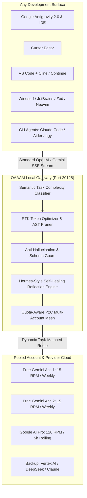
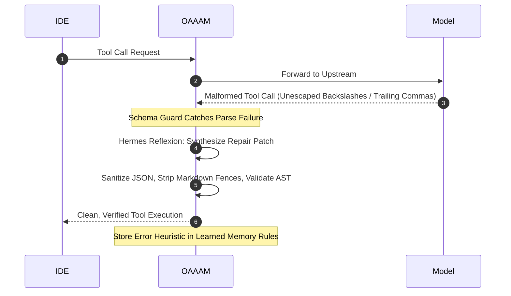

# ⚡ OAAAM — OmniAutoAiAgentMesh

<div align="center">

[](https://opensource.org/licenses/MIT)
[](https://nodejs.org)
[](https://hub.docker.com)
[](https://github.com)
[](https://github.com)
[](https://github.com)
[](https://github.com)

**Next-Gen Intelligent Multi-Account AI Mesh, Token Optimizer, Anti-Hallucination Guard, and Self-Healing Gateway.**

*Unified, zero-drop AI copilot routing for Google Antigravity 2.0, Antigravity IDE, Cursor, VS Code, Windsurf, JetBrains, Zed, Neovim, and Autonomous Agent Frameworks.*

[Quickstart](#-installation--quickstart) •
[CLI Reference](#-complete-cli-command-reference) •
[All Platforms & OS](#-complete-operating-system--platform-setup-guides) •
[All IDEs & Apps](#-complete-application--ide-integration-guides) •
[Anti-Hallucination](#-anti-hallucination-guardrails) •
[Self-Healing Engine](#-hermes-style-self-healing--error-recovery) •
[Failover Matrix](#-complete-event-logic--failover-matrix)

</div>

---

## 📖 Table of Contents
1. [Overview & Why OAAAM Was Built](#-overview--why-oaaam-was-built)
2. [Key Innovations & Architecture](#-key-innovations--architecture)
3. [Anti-Hallucination Guardrails](#-anti-hallucination-guardrails)
4. [Hermes-Style Self-Healing & Error Recovery](#-hermes-style-self-healing--error-recovery)
5. [Complete CLI Command Reference](#-complete-cli-command-reference)
6. [Complete Operating System & Platform Setup Guides](#-complete-operating-system--platform-setup-guides)
   - [Windows 10/11 (Native & PowerShell)](#1-windows-10--11-native)
   - [macOS (Apple Silicon & Intel)](#2-macos-apple-silicon-m1-m4--intel)
   - [Linux (Ubuntu, Debian, Fedora, Arch + systemd)](#3-linux-ubuntudebianfedoraarch--systemd-daemon)
   - [Docker & Docker Compose](#4-docker--docker-compose)
   - [Windows Subsystem for Linux (WSL 1 & 2)](#5-windows-subsystem-for-linux-wsl-1--2)
   - [Android (Termux Mobile)](#6-android-termux-mobile)
   - [Cloud VPS (AWS, DigitalOcean, Hetzner, GCP)](#7-cloud-vps-aws-ec2-digitalocean-hetzner)
7. [Complete Application & IDE Integration Guides](#-complete-application--ide-integration-guides)
   - [Google Antigravity 2.0 & Antigravity IDE](#1-google-antigravity-20--antigravity-ide)
   - [Antigravity CLI (`agy`)](#2-antigravity-cli-agy)
   - [Cursor AI Editor](#3-cursor-ai-editor)
   - [VS Code (Cline, Continue, Roo Code, OpenCode)](#4-vs-code-cline-continue-roo-code-opencode)
   - [Windsurf Editor / Codeium](#5-windsurf-editor--codeium)
   - [JetBrains IDEs (IntelliJ, PyCharm, WebStorm, GoLand)](#6-jetbrains-ides-intellij-pycharm-webstorm-goland)
   - [Zed Editor](#7-zed-editor)
   - [Neovim (Avante.nvim, CodeCompanion.nvim)](#8-neovim-avante-codecompanion)
   - [Terminal Agents (Claude Code, Aider, AutoGen, CrewAI)](#9-terminal-agents-claude-code-aider-autogen-crewai)
8. [Dynamic Automation vs. Manual Tweaks](#-dynamic-automation-vs-manual-tweaks)
9. [Complete Event, Logic & Failover Matrix](#-complete-event-logic--failover-matrix)
10. [Fine-Tuning & Custom Configuration](#-fine-tuning--custom-configuration)
11. [Troubleshooting & Diagnostics (`oaaam doctor`)](#-troubleshooting--diagnostics)
12. [Security Architecture & Zero-Telemetry Guarantee](#-security-architecture)

---

## 🎯 Overview & Why OAAAM Was Built

Developers working with AI-first IDEs face persistent quota walls, rate limits, and context bloat:

* **The Quota & Rate Limit Wall (`HTTP 429 RESOURCE_EXHAUSTED`):** Free accounts hit strict 15 RPM ceilings; paid accounts exhaust rolling 5-hour burst quotas during agentic loops, aborting in-flight work.
* **Context Bloat & Token Burn:** Every IDE turn resends the entire file tree, recent files, and diagnostic logs, wasting thousands of billable tokens on boilerplate.
* **Model Misallocation:** Simple tasks (docstrings, typo fixes) are routinely sent to heavy, expensive Pro models, needlessly consuming premium quotas.
* **Tool Call Hallucinations:** Models emit unescaped Windows paths, invalid JSON strings, and missing schema arguments, causing agents to crash.

**OAAAM (OmniAutoAiAgentMesh)** is an intelligent, local-first gateway that pools multiple accounts (free and paid), classifies task complexity, automatically allocates models, compresses token context, validates against hallucinations, and auto-heals failed tool calls in real time.

---

## 🌟 Key Innovations & Architecture



### 1. Quota-Aware P2C Multi-Account Mesh
* Pools multiple Free (`@gmail.com`) and Paid (Google AI Pro, Ultra, Vertex AI) accounts.
* Monitors **Rolling 5-Hour Refill Buckets** for paid tiers and **Weekly Windows** for free tiers.
* Uses the **Power-of-Two-Choices (P2C)** algorithm to route requests to the account with maximum headroom.
* **Transparent 50ms Failover:** Replays requests across accounts upon receiving HTTP 429 errors without interrupting the IDE session.

### 2. Semantic Task Complexity Classifier
Profiles incoming prompts and allocates models dynamically:
* **Tier 1 (Micro/Syntax):** Tab autocomplete, docstrings, variable renaming $\to$ **Free Gemini Flash** (< 400ms latency, zero cost).
* **Tier 2 (Tactical Code):** Function generation, unit test suites, bug fixes $\to$ **Gemini Flash (Thinking) / Pro Free**.
* **Tier 3 (Strategic Reasoning):** Multi-file architecture, distributed debugging $\to$ **Gemini Pro / Ultra on Paid Subscription**.

### 3. Real-Time Token Optimizer & AST Pruner
* Strips redundant whitespace, collapses duplicate comment blocks, and cleans ASCII box borders from IDE logs.
* **Semantic Prompt Caching:** Uses SHA256 context signatures to return cached results for unchanged turns at **0 token cost**.
* **Token Savings:** Reduces billable input tokens by **15% to 65%**.

---

## 🛡️ Anti-Hallucination Guardrails

OAAAM includes an active verification guard (`src/guardrails/anti-hallucination.ts`):

1. **Strict Tool Schema Enforcement:** Intercepts model-generated tool calls and validates required parameters before execution, blocking malformed dispatches.
2. **Context Grounding Verification:** Verifies that imported packages, symbols, and file paths exist in the active workspace context or standard language libraries.
3. **Deterministic Sampling Calibration:** Automatically applies low temperature ($0.1 - 0.2$) and strict `top_p` sampling for code generation and refactoring, while permitting higher entropy for brainstorming tasks.

---

## 🔄 Hermes-Style Self-Healing & Error Recovery

Inspired by **Nous Research’s Hermes-Agent** (`nousresearch/hermes-agent`), OAAAM includes an autonomous reflection and self-healing engine (`src/healing/self-healer.ts`):



* **Autonomous Tool Call Repair:** Automatically corrects unescaped Windows paths (`C:\app` $\to$ `C:\\app`), strips markdown code blocks enclosing JSON, and removes trailing commas.
* **Reflective Error Memory:** Tracks recurring model mistakes and injects corrective guidance into subsequent turns.
* **Adaptive Rate Curve Learning:** Learns actual rate curves dynamically from upstream headers, preemptively throttling calls to prevent lockouts.

---

## 💻 Complete CLI Command Reference

The `oaaam` CLI provides unified management for the gateway service, accounts, and IDE connections:

```bash
oaaam <command> [options]
```

| Command | Arguments | Description |
| :--- | :--- | :--- |
| **`oaaam start`** | `[--daemon, -d]` | Starts the OAAAM gateway (foreground or background service). |
| **`oaaam stop`** | — | Stops the background OAAAM daemon process. |
| **`oaaam restart`** | — | Safely restarts the gateway service. |
| **`oaaam status`** | — | Displays gateway health, PID, port, active accounts, and IDE routes. |
| **`oaaam update`** | — | Pulls the latest commits from GitHub or updates the global npm package. |
| **`oaaam upgrade`** | — | Alias for `update`. Upgrades codebase and rebuilds binaries. |
| **`oaaam doctor`** | — | Runs system diagnostics (Node version, ports, permissions, IDE paths). |
| **`oaaam stats`** | — | Displays real-time token savings and cost economy metrics. |
| **`oaaam account list`** | — | Lists all configured accounts, active tiers, RPM meters, and quotas. |
| **`oaaam account add`** | `<id> <name> <tier> <key>` | Adds a new Gemini account to the mesh pool. |
| **`oaaam account delete`** | `<id>` | Removes an account from the mesh pool. |
| **`oaaam ide connect`** | `<antigravity\|cursor\|vscode\|all>` | Injects OAAAM gateway settings into the specified IDE. |
| **`oaaam ide disconnect`**| `<antigravity\|cursor\|vscode\|all>` | Reverts the specified IDE to direct/default settings. |

---

## 🖥️ Complete Operating System & Platform Setup Guides

### 1. Windows 10 / 11 (Native)
```powershell
# In PowerShell (Run as Administrator recommended for global binary link):
cd c:\Users\ommed\Desktop\antigravity\antigravity_multi_auth
npm install
npm run build

# Start the gateway as a background daemon
node dist/cli.js start --daemon

# Check status and run health diagnostics
node dist/cli.js status
node dist/cli.js doctor
```

### 2. macOS (Apple Silicon M1-M4 & Intel)
```bash
# Clone and install
git clone https://github.com/your-username/oaaam.git ~/.oaaam-core
cd ~/.oaaam-core
npm install && npm run build
npm link

# Launch in background
oaaam start --daemon

# Open Control Center
open http://localhost:20128
```

### 3. Linux (Ubuntu/Debian/Fedora/Arch + systemd Daemon)
To run OAAAM as a persistent system service that auto-starts on boot:
```bash
# 1. Build project
cd /opt/oaaam && npm install && npm run build

# 2. Create systemd service unit
sudo tee /etc/systemd/system/oaaam.service << EOF
[Unit]
Description=OAAAM OmniAutoAiAgentMesh Gateway
After=network.target

[Service]
Type=simple
User=$USER
WorkingDirectory=/opt/oaaam
ExecStart=/usr/bin/node /opt/oaaam/dist/server.js
Restart=always
RestartSec=5
Environment=PORT=20128

[Install]
WantedBy=multi-user.target
EOF

# 3. Enable and start
sudo systemctl daemon-reload
sudo systemctl enable --now oaaam
```

### 4. Docker & Docker Compose
```bash
# Single command launch
docker compose up -d

# Verify logs and health
docker compose logs -f
curl http://localhost:20128/api/stats
```

### 5. Windows Subsystem for Linux (WSL 1 & 2)
```bash
# In your WSL terminal:
cd ~/oaaam && npm install && npm run dev
# Windows host IDEs can connect directly via http://localhost:20128/v1
```

### 6. Android (Termux Mobile)
```bash
pkg update && pkg install nodejs git -y
git clone https://github.com/your-username/oaaam.git
cd oaaam && npm install
node dist/server.js
```

### 7. Cloud VPS (AWS EC2, DigitalOcean, Hetzner)
Deploy on a remote VPS to share an account pool across your entire engineering team:
```bash
export PORT=20128
node dist/server.js &
# Protect endpoint using standard Nginx reverse proxy with Bearer Auth / SSL.
```

---

## 🔌 Complete Application & IDE Integration Guides

### 1. Google Antigravity 2.0 & Antigravity IDE
* **Method A (CLI):**
  ```bash
  oaaam ide connect antigravity
  ```
* **Method B (Native Sidecar):**
  Create `~/.gemini/config/sidecars/oaaam/sidecar.json`:
  ```json
  {
    "display_name": "OAAAM Mesh Gateway",
    "command": "node",
    "args": ["dist/server.js"],
    "restart_policy": "always"
  }
  ```
* **Method C (Environment Variable):**
  ```bash
  export GOOGLE_GEMINI_BASE_URL="http://localhost:20128/v1"
  ```

### 2. Antigravity CLI (`agy`)
In `~/.gemini/antigravity-cli/settings.json`:
```json
{
  "modelProvider": "gemini",
  "apiEndpoint": "http://localhost:20128/v1"
}
```

### 3. Cursor AI Editor
* **Method A (CLI):**
  ```bash
  oaaam ide connect cursor
  ```
* **Method B (Manual UI):**
  1. Open Cursor Settings $\to$ **Models**.
  2. Set **OpenAI API Base URL** to: `http://localhost:20128/v1`
  3. Enter any API key (e.g. `oaaam-local`).
  4. Model: `auto-smart-router` or `gemini-2.5-pro`.

### 4. VS Code (Cline, Continue, Roo Code, OpenCode)
* **Continue:** In `~/.continue/config.json`:
  ```json
  {
    "models": [
      {
        "title": "OAAAM Dynamic Mesh",
        "provider": "openai",
        "model": "auto-smart-router",
        "apiBase": "http://localhost:20128/v1",
        "apiKey": "oaaam-local"
      }
    ]
  }
  ```
* **Cline / Roo Code:**
  Set API Provider to `OpenAI Compatible`, Base URL to `http://localhost:20128/v1`.

### 5. Windsurf Editor / Codeium
In Windsurf Settings $\to$ **Custom Provider / Proxy**:
* **Base URL:** `http://localhost:20128/v1`
* **API Key:** `oaaam-local`

### 6. JetBrains IDEs (IntelliJ, PyCharm, WebStorm, GoLand)
Using the Continue or JetBrains AI Assistant plugin:
* Set Provider to `OpenAI Compatible`
* Endpoint: `http://localhost:20128/v1`

### 7. Zed Editor
In `~/.config/zed/settings.json`:
```json
{
  "language_models": {
    "openai": {
      "api_url": "http://localhost:20128/v1"
    }
  }
}
```

### 8. Neovim (Avante, CodeCompanion)
In `init.lua` (for Avante.nvim):
```lua
require('avante').setup({
  provider = "openai",
  openai = {
    endpoint = "http://localhost:20128/v1",
    model = "auto-smart-router",
    api_key_name = "OAAAM_KEY",
  }
})
```

### 9. Terminal Agents (Claude Code, Aider, AutoGen, CrewAI)
```bash
export OPENAI_BASE_URL="http://localhost:20128/v1"
export ANTHROPIC_BASE_URL="http://localhost:20128/v1"
export GOOGLE_GEMINI_BASE_URL="http://localhost:20128/v1"
export OPENAI_API_KEY="oaaam-local"

# Run Aider
aider --model openai/auto-smart-router

# Run Claude Code via gateway
claude
```

---

## ⚙️ Dynamic Automation vs. Manual Tweaks

| Feature | What OAAAM Does Automatically (Dynamic) | What You Can Configure Manually |
| :--- | :--- | :--- |
| **Account Load Balancing** | Balances load via P2C algorithm; fails over in 50ms upon 429 errors. | Add/delete accounts via `oaaam account add/delete` or set static priority weights. |
| **Model Classification** | Profiles prompts and routes to Flash, Thinking, or Pro models based on complexity. | Force a specific model via your IDE dropdown or API parameter. |
| **Token Optimization** | Prunes whitespace, collapses repeated comments, caches repeated prompts. | Adjust compression aggressiveness levels in `src/optimizer/compressor.ts`. |
| **IDE Injection** | Detects installed IDEs and injects proxy endpoints with 1 click. | Point custom editors to `http://localhost:20128/v1` manually. |
| **Self-Healing Recovery** | Fixes unescaped Windows paths and invalid JSON tool arguments in real time. | Add custom reflection rules and memory heuristics to `src/healing/self-healer.ts`. |

---

## 📊 Complete Event, Logic & Failover Matrix

| Trigger / Condition | Upstream Signal | OAAAM Detection Mechanism | Gateway Action | State Preservation |
| :--- | :--- | :--- | :--- | :--- |
| **Micro Syntax Task** | Input < 1.2kb + syntax keywords | Semantic Task Classifier | Routes to Free Gemini Flash | Sub-second response, 0 cost |
| **Tactical Code Work** | Function gen, unit test, refactor | Semantic Task Classifier | Routes to Flash-Thinking / Pro Free | Balanced token economy |
| **Strategic Reasoning** | Context > 15kb or multi-file keywords | Semantic Task Classifier | Routes to Paid Pro Subscription | Deep reasoning capacity preserved |
| **Free Tier RPM Hit** | `HTTP 429` with `retry-after` header | Rate limit header parser | Instant switch to Free Acc 2 (50ms) | Request buffered & retransmitted |
| **Free Daily Quota Full** | `HTTP 429` (`RESOURCE_EXHAUSTED`) | Quota preflight inspector | Lock account for 24h; escalate to Paid | Session continues uninterrupted |
| **Paid 5h Bucket Full** | `HTTP 429` (`RATE_LIMIT_EXCEEDED`) | Rolling window usage tracker | Downgrade to Flash pool until reset | Full transcript preserved in JSONL |
| **Malformed Tool Execution** | Invalid JSON / unescaped path | Anti-Hallucination Guard | Hermes Reflexion auto-repairs payload | Tool executes cleanly in IDE |
| **Phantom Import Detected** | Output references unverified package | Context Grounding Guard | Flags violation; injects grounded context | Prevents broken dependencies |
| **Repeated Context Keystroke** | Identical prompt signature | SHA256 Prompt Cache | Returns cached response instantly | **0 billable tokens consumed** |

---

## 🛠️ Fine-Tuning & Custom Configuration

Configure account thresholds and models in `src/accounts/manager.ts`:

```typescript
const customAccount: GeminiAccount = {
  id: 'custom-pro-1',
  name: 'Custom Team Gemini Pro',
  tier: 'paid_pro',
  apiKey: process.env.GEMINI_KEY || 'AIzaSy...',
  maxRpm: 120,                      // Custom RPM cap
  maxTpm: 5000000,                  // Custom TPM cap
  rollingWindowLimit: 5000000,      // 5-hour rolling token capacity
  windowResetTime: Date.now() + 5 * 3600 * 1000,
  status: 'active',
  cooldownUntil: 0,
  priority: 1
};
```

---

## 🩺 Troubleshooting & Diagnostics

Run system diagnostics at any time:
```bash
oaaam doctor
```

Output:
```text
🩺 Running OAAAM System Diagnostics...
 • Node.js Environment:   v20.14.0 [OK]
 • Platform / Architecture: win32 (x64) [OK]
 • Default Port (20128):    Available [OK]
 • Storage Directory:       C:\Users\...\.oaaam [OK]
 • IDE Found: Google Antigravity 2.0 & IDE -> Detected
 • IDE Found: Cursor AI Editor         -> Detected
[✓] OAAAM system health check passed. Ready for agent orchestration!
```

---

## 🔒 Security Architecture

* **Zero Cloud Telemetry:** No user data or prompts leave your machine except to communicate directly with Google's official API endpoints.
* **Localhost-Only Binding:** Binds strictly to `127.0.0.1`, preventing unauthorized external network access.
* **Local Storage:** All account credentials and configuration files reside strictly under `~/.oaaam/`.

---

## 📄 License

This project is licensed under the **MIT License** — free for individual, open-source, and commercial use.
